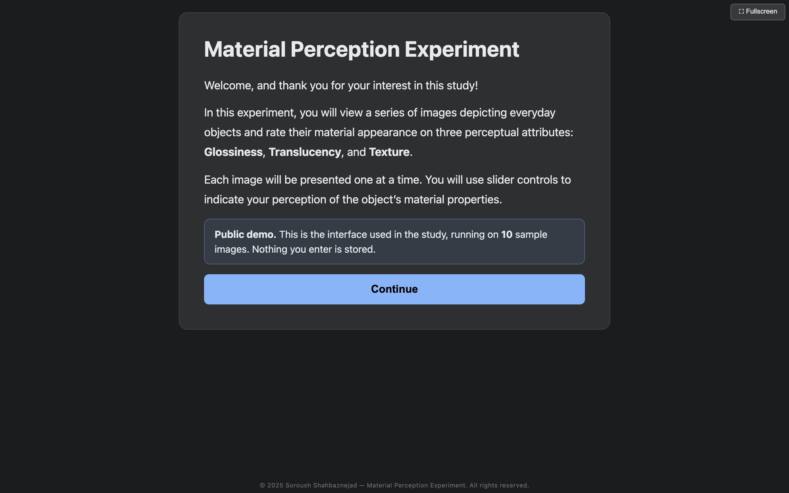
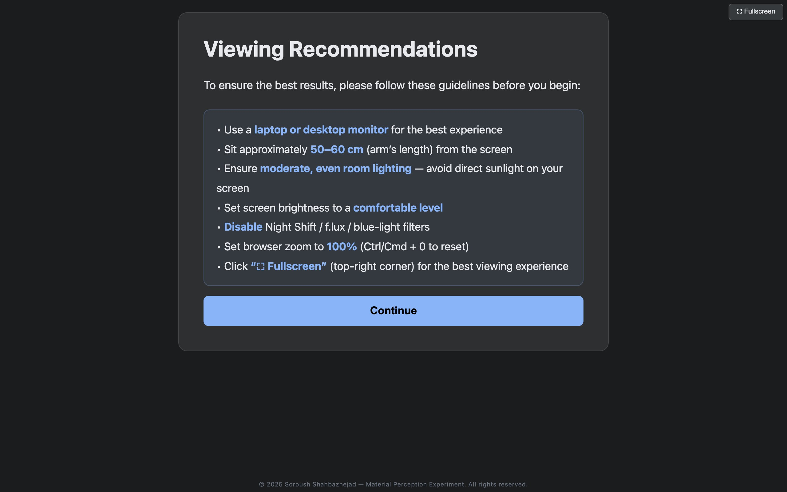
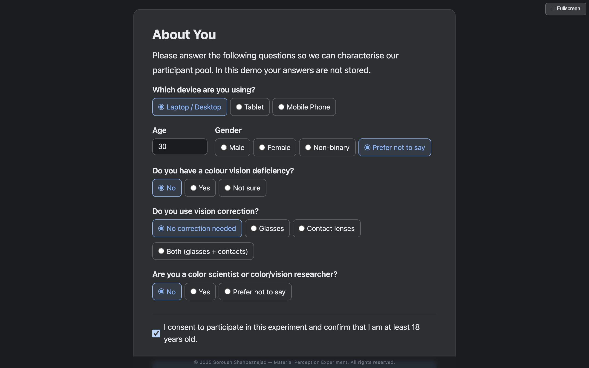
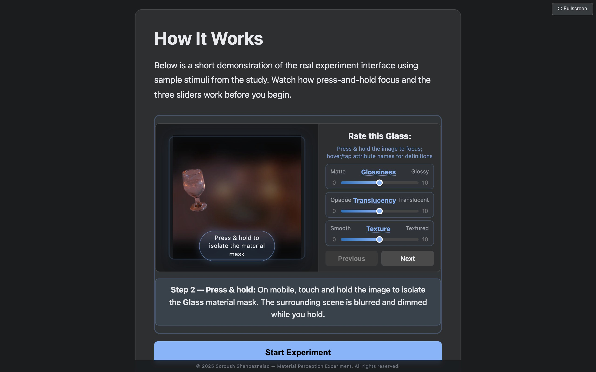
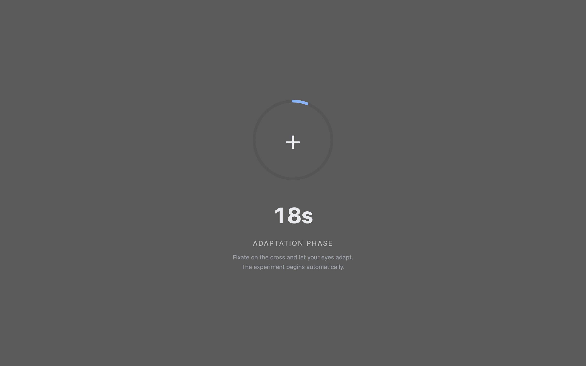
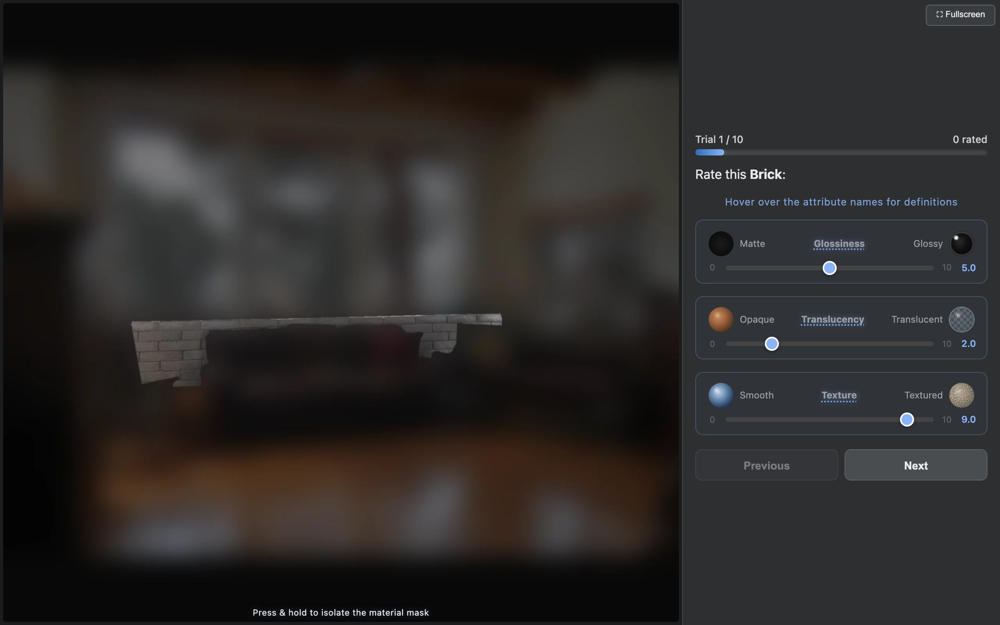
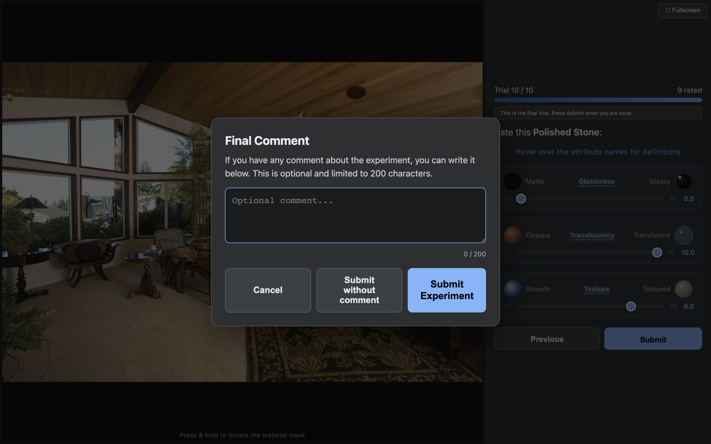
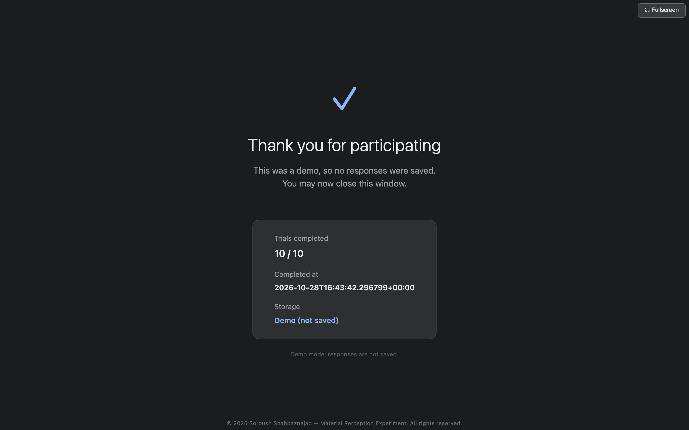

<h1 align="center">Material Perception Experiment</h1>

<p align="center">
  An online psychophysics experiment for rating the glossiness, translucency, and texture of materials in real photographs.
</p>

<p align="center">
  
  
  
</p>

---

## Overview

This repository contains the web application used to collect perceptual material ratings for our study. Each trial shows one real photograph with a target material region. Observers rate that material on three continuous scales:

| Attribute | Low anchor (0) | High anchor (10) |
|---|---|---|
| Glossiness | Matte | Glossy |
| Translucency | Opaque | Translucent |
| Texture | Smooth | Textured |

The full scene is always visible for context. Pressing and holding the image switches to a focus view in which the target material stays sharp while the rest of the scene is blurred and dimmed, so observers know which region to rate without losing the surrounding context.

**Live demo:** _add the demo URL here_

The repository runs in **demo mode** by default: the complete interface (instructions, demographics form, tutorial, adaptation, rating trials, and completion screen) on 10 sample images. The demo does not store anything; ratings and form answers are discarded when you finish.

---

## Experiment walkthrough

| | |
|---|---|
|  |  |
| **1. Welcome.** Introduces the task and the three attributes. | **2. Viewing recommendations.** Desktop where possible, arm's-length viewing distance, moderate even lighting, 100% browser zoom, and no blue-light filters. |
|  |  |
| **3. About you.** Device, age, gender, colour-vision deficiency, vision correction, and colour-science background, plus consent. | **4. Tutorial.** An animated walkthrough of the real interface, including the press-and-hold focus view and the three sliders. |
|  |  |
| **5. Adaptation.** A 20-second fixation screen on a mid-grey background before the first trial. | **6. Rating trial.** The target material is named in the prompt; the image is shown here with the focus view active. |
|  |  |
| **7. Final comment.** An optional comment of up to 200 characters. | **8. Completion.** Confirms the session is finished. |

---

## Study design

The study version assigns each observer one of three rotating batches of 110 trials:

- **15 shared anchor stimuli**, shown in every batch and spread evenly through the sequence, used to calibrate ratings across batches.
- **93 batch-specific stimuli**, so the three batches together cover the full stimulus pool.
- **2 hidden repeats** of earlier trials, placed at least 20 trials after the original, used to check within-observer consistency.

Trial order is shuffled per observer with a seed derived from the participant ID, so a session can be resumed in exactly the same order. A short break message appears every 50 trials.

### Rationale

Material perception is a mid-level vision problem: observers infer surface properties from images that are also shaped by illumination, exposure, 3D shape, object identity, and scene context. The ratings collected here are perceptual estimates, not physical measurements. The protocol was designed to:

- use natural photographs, so materials are judged under real-world lighting and shape variation rather than only synthetic renderings;
- keep the full scene visible, because material appearance depends on illumination and surrounding objects;
- use a masked focus view to remove ambiguity about which region is being rated;
- collect continuous 0–10 ratings, which can be analysed as psychophysical scales rather than only coarse categories;
- record the response time of every trial for quality control and analysis of difficulty.

This is not a colour-calibrated laboratory setup. The ratings should be treated as online perceptual judgements made on participants' own displays.

---

## Attribute definitions

| Attribute | Working definition | Main visual cues | References |
|---|---|---|---|
| Glossiness | Perceived shininess or specular reflectance. Near 0 is matte and diffuse; near 10 is glossy or mirror-like. | Specular highlights, highlight sharpness and contrast, reflections, and how highlights relate to surface shape. | [Chadwick & Kentridge, 2015](https://pubmed.ncbi.nlm.nih.gov/25448119/); [Fleming, Dror & Adelson, 2003](https://pubmed.ncbi.nlm.nih.gov/12875632/); [Motoyoshi et al., 2007](https://www.nature.com/articles/nature05724) |
| Translucency | Perceived degree to which light enters, scatters within, or passes through the material. Near 0 is opaque; near 10 is highly translucent (wax, skin, jade, glass). | Soft glow, reduced shading contrast, backlighting, and luminance that does not follow surface orientation. | [Fleming & Bülthoff, 2005](https://doi.org/10.1145/1077399.1077409); [Motoyoshi, 2010](https://doi.org/10.1167/10.9.6); [Marlow, Kim & Anderson, 2017](https://pmc.ncbi.nlm.nih.gov/articles/PMC5748181/) |
| Texture | Perceived surface structure, roughness, or patterning. Near 0 is smooth and uniform; near 10 is rough, patterned, granular, or fibrous. | Spatial frequency, repetition, contrast, directionality, coarseness, and visible relief. | [Rao & Lohse, 1996](https://doi.org/10.1016/0042-6989(95)00202-2); [Ho, Landy & Maloney, 2008](https://pmc.ncbi.nlm.nih.gov/articles/PMC2679902/); [Fleming, 2017](https://www.annualreviews.org/doi/10.1146/annurev-vision-102016-061429) |

The three attributes are related: texture can change perceived gloss, and highlights can make surface relief more salient. All three are collected on every stimulus so these interactions can be analysed.

---

## Rating method

Each attribute is a horizontal graphic rating scale with verbal end anchors and values from 0 to 10.

- Sliders move in steps of 0.1.
- On a new trial the sliders start at positions drawn from a seed of the participant ID and trial, which avoids a fixed centre-start anchoring bias.
- Each response stores the three ratings, stimulus metadata, trial position, batch, timestamp, and response time.
- Observers can go back to the previous trial and change their answer.

The scale measures relative perceptual judgements. It should not be read as a physical BRDF, scattering coefficient, or measured roughness.

---

## Running the demo locally

Requires Python 3.10 or newer.

```bash
git clone https://github.com/soroushshahbaznejad/material-perception-experiment.git
cd material-perception-experiment
python -m venv .venv && source .venv/bin/activate
pip install -r requirements.txt
python flask_app.py
```

Then open <http://localhost:7860>. No database or environment variables are needed.

Optionally, pre-render the focus images for faster loading:

```bash
python prerender_stimuli.py
```

## Running the full study

Data collection is switched off in this repository. To run the batched study with your own stimuli:

1. Put a stimulus manifest at `stimuli/stimuli.csv` (or point `STIMULI_CSV` at one). It uses the same columns as [`demo/stimuli.csv`](demo/stimuli.csv), plus `batch_id`, `is_anchor`, and `is_qc_eligible` for the batch design.
2. Create a Supabase project and run [`supabase_schema.sql`](supabase_schema.sql).
3. Start the app with:

```bash
DEMO_MODE=0 SUPABASE_URL=... SUPABASE_KEY=... SESSION_SIGNING_SECRET=... python flask_app.py
```

---

## Project layout

```text
flask_app.py           Flask routes, session handling, trial payloads
experiment_core.py     Batch assignment, anchors, QC repeats, trial order, responses
stimulus_rendering.py  Polygon mask and focus/blur rendering
storage.py             Supabase session storage and the no-op demo store
prerender_stimuli.py   Optional WebP pre-rendering of all stimuli
templates/index.html   Single-page experiment interface
demo/                  10 demo photographs, polygon annotations, and manifest
docs/screenshots/      Screenshots used in this README
supabase_schema.sql    Database schema for the full study
```

---

## Data availability

The full stimulus set and the ratings collected in the study are not included in this repository. Please contact the author about access.

## Image credits

The stimuli are derived from [OpenSurfaces](https://opensurfaces.cs.cornell.edu/) (Bell et al., 2013), a catalogue of annotated photographs of real-world surfaces. The 10 demo photographs keep the licences of their original OpenSurfaces sources.

> Sean Bell, Paul Upchurch, Noah Snavely, Kavita Bala. "OpenSurfaces: A Richly Annotated Catalog of Surface Appearance." ACM Transactions on Graphics (SIGGRAPH), 2013.

---

## References

- Bell, S., Upchurch, P., Snavely, N., & Bala, K. (2013). [OpenSurfaces: A Richly Annotated Catalog of Surface Appearance](https://www.cs.cornell.edu/~sbell/pdf/siggraph2013-opensurfaces.pdf). ACM Transactions on Graphics, SIGGRAPH.
- Chadwick, A. C., & Kentridge, R. W. (2015). [The perception of gloss: A review](https://pubmed.ncbi.nlm.nih.gov/25448119/). Vision Research.
- Fleming, R. W. (2017). [Material Perception](https://www.annualreviews.org/doi/10.1146/annurev-vision-102016-061429). Annual Review of Vision Science.
- Fleming, R. W., & Bülthoff, H. H. (2005). [Low-level image cues in the perception of translucent materials](https://doi.org/10.1145/1077399.1077409). ACM Transactions on Applied Perception.
- Fleming, R. W., Dror, R. O., & Adelson, E. H. (2003). [Real-world illumination and the perception of surface reflectance properties](https://pubmed.ncbi.nlm.nih.gov/12875632/). Journal of Vision.
- Freyd, M. (1923). [The graphic rating scale](https://doi.org/10.1037/h0074329). Journal of Educational Psychology.
- Ho, Y.-X., Landy, M. S., & Maloney, L. T. (2008). [Conjoint measurement of gloss and surface texture](https://pmc.ncbi.nlm.nih.gov/articles/PMC2679902/). Psychological Science.
- Marlow, P. J., Kim, J., & Anderson, B. L. (2017). [Perception and misperception of surface opacity](https://pmc.ncbi.nlm.nih.gov/articles/PMC5748181/). Proceedings of the National Academy of Sciences.
- Motoyoshi, I. (2010). [Highlight-shading relationship as a cue for the perception of translucent and transparent materials](https://doi.org/10.1167/10.9.6). Journal of Vision.
- Motoyoshi, I., Nishida, S., Sharan, L., & Adelson, E. H. (2007). [Image statistics and the perception of surface qualities](https://www.nature.com/articles/nature05724). Nature.
- Rao, A. R., & Lohse, G. L. (1996). [Towards a texture naming system: Identifying relevant dimensions of texture](https://doi.org/10.1016/0042-6989(95)00202-2). Vision Research.
- Stevens, S. S. (1957). [On the psychophysical law](https://doi.org/10.1037/h0046162). Psychological Review.

---

## Copyright

Copyright (c) 2025 Soroush Shahbaznejad. All rights reserved.

The code is shared so the experiment can be inspected and reproduced for academic research. Redistribution or commercial use requires prior written permission from the author.
